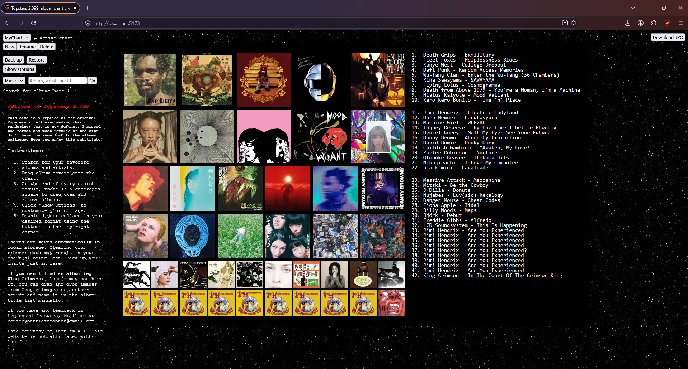

# Topster 2.099 - Album Chart Creator

An album chart maker that is a replica of the now defunct Topsters 2 (never-ending-chart-rendering) where you can search for albums, arrange them into a collage, and download the result as a JPG. I missed the format and most remakes of the site don't have the same look to the albums collages. Hope you enjoy this substitute!

> Not affiliated with Topsters or Last.fm.

## Features
- **Three layouts:** Top 42 (sections of 10, 12, 20), Top 100 (sections of 10, 18, 30, 42), and a Collage with sliders for 1-12 rows and 1-12 columns (144 total albums).
- **Album search:** uses the Last.fm API. Drag an ablum onto a slot, or click to add on mobile.
- **Drag your own images:** drag in a picture from Google Images or a file from your computer, then type its "Artist - Album" name in the titles list. You can double click it to re-title.
- **Multiple charts:** create, rename, and delete charts. Everything autosaves in local storage.
- **Backup and restore:** export all charts to a JSON file and restore them later.
- **Download JPG:** the downloaded image matches what you see at any window size.



## Tech Stack
* **Language:** TypeScript
* **Frameworks/Libraries:** React, Vite
* **APIs and services:** Last.fm API, Vercel Hosting and Vercel Analytics

## Installation

You need Node.js 18 or newer and a free [Last.fm API key](https://www.last.fm/api/account/create) and create a .env file.

```bash
npm install

# Start the dev server
npm run dev

# Build for production
npm run build
```

## Credits
Album data and artwork courtesy of [Last.fm](https://www.last.fm). Inspired by the original Topsters. 

Reach out to boundbybattlefeedback@gmail.com for feedback, bugs found, or requested features. Thank you.